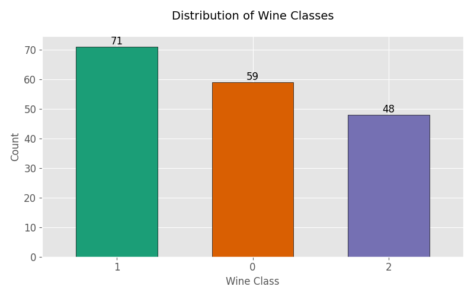
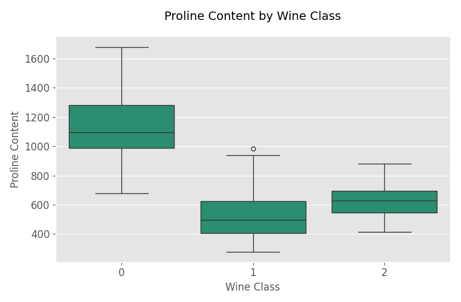
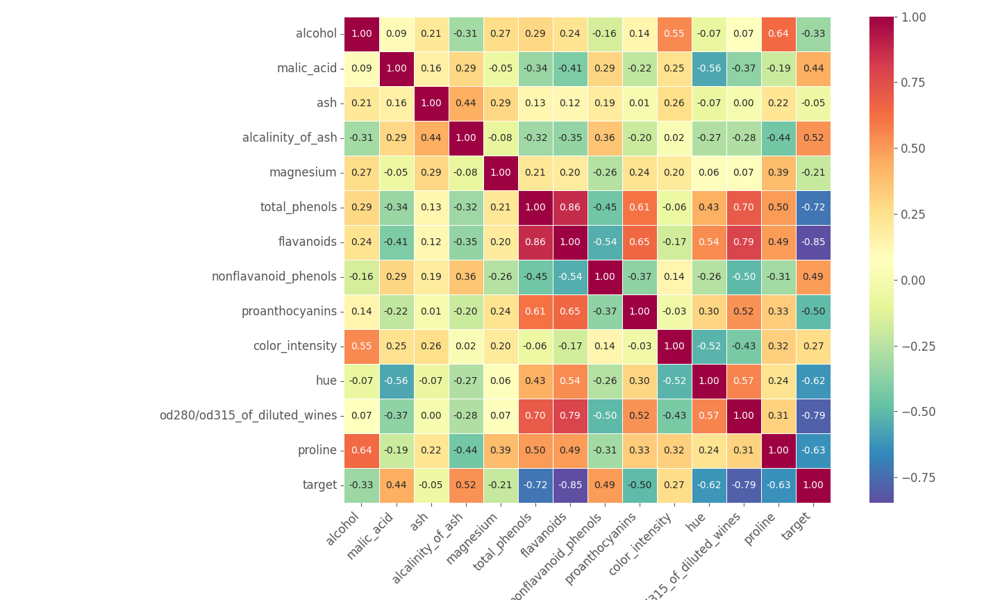
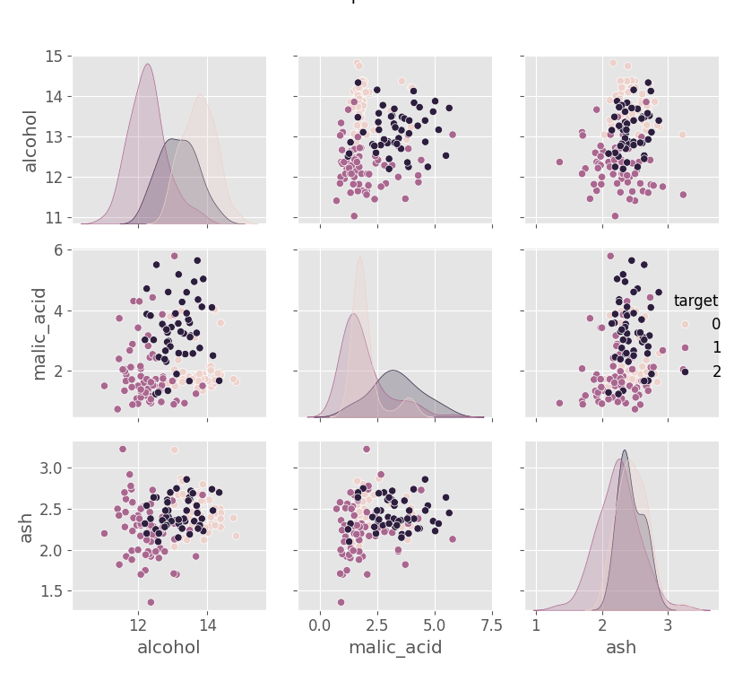

# Wine Dataset Analysis and Visualization

This project performs an exploratory data analysis (EDA) of the well-known Wine dataset. The goal is to understand the relationships between different chemical attributes of wines and their corresponding classes.

## Visualizations

Here are some of the key visualizations from the analysis:

**1. Distribution of Wine Classes**

**2. Proline Content by Wine Class**

**3. Relationship Between Proline and Flavanoids**

**4. Feature Correlation Heatmap**

**5. Pairwise Relationships of Selected Features**

## How to Run the Code

To run this analysis yourself, you will need to have Python installed, along with the following libraries:

*   pandas
*   matplotlib
*   seaborn
*   scikit-learn

You can install these with pip:
`pip install pandas matplotlib seaborn scikit-learn`

Then, you can run the Python script:
`python wine_analysis.py`

## About the Dataset

The data is the result of a chemical analysis of wines grown in the same region in Italy but derived from three different cultivars. The analysis determined the quantities of 13 constituents found in each of the three types of wines.
